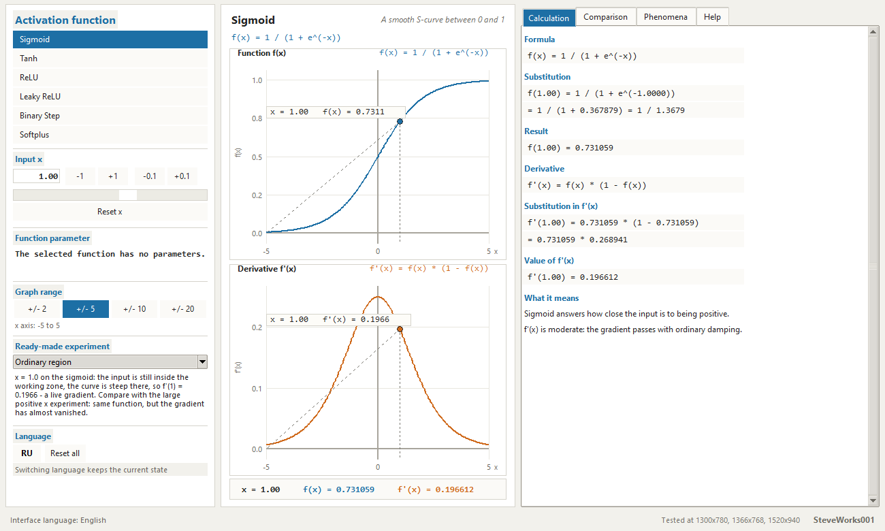
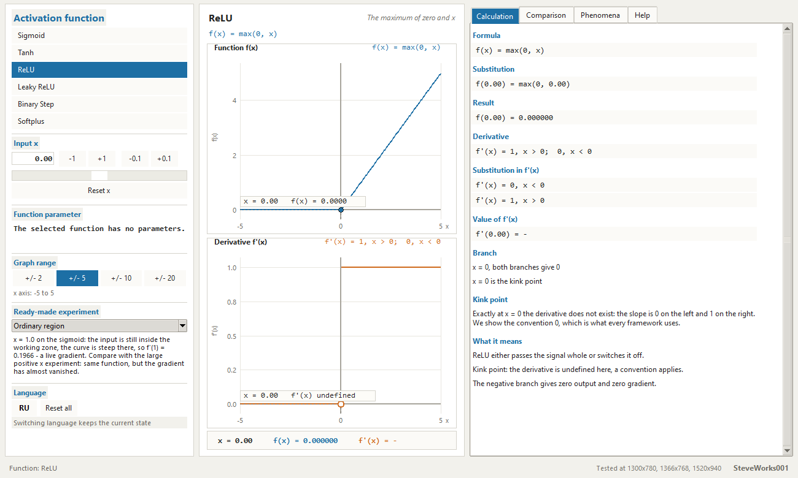
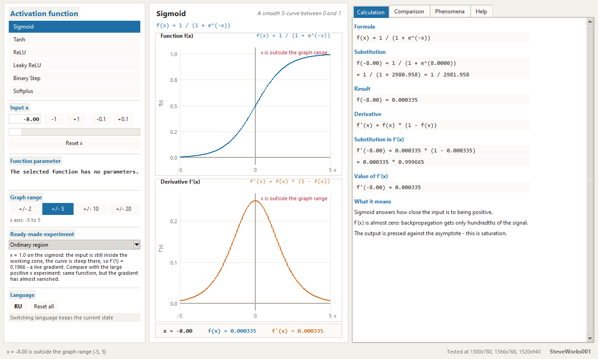
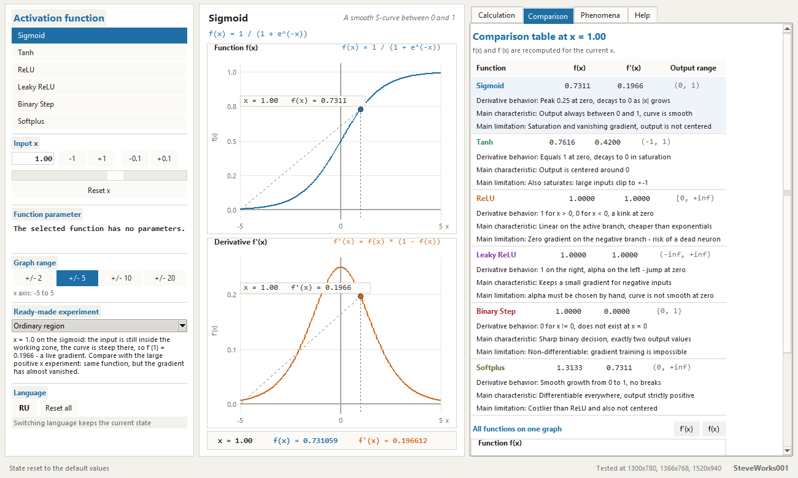
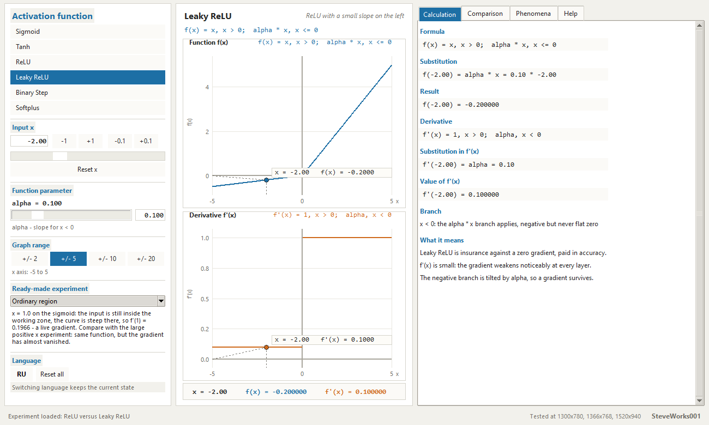
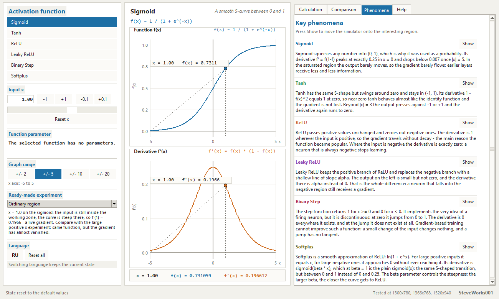
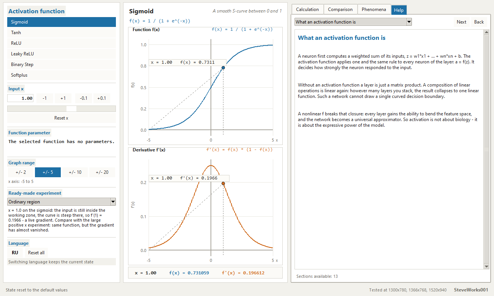

# Activation Functions Lab — an educational simulator

Project 7 of 13 in the educational neural-network simulator series.
A single-file Python and Tkinter application: standard library only, no
external packages, no network access, nothing to install. The chain
"x → f(x) → f'(x) → what happens to the gradient" is shown for six activation
functions in three forms at once: as large numbers, as two graphs (the function
and its derivative), and as a line-by-line substitution.

Russian version: [README_RU.md](README_RU.md).

---

## Purpose

Show with real numbers what an activation function does to a gradient. For any
input the app answers two different questions at once: what the neuron outputs
(`f(x)`) and how much that output depends on the input at all (`f'(x)`). Each
pair of numbers comes with a short sentence about what it means for training —
"f'(x) is close to 1: the gradient passes almost without loss", "f'(x) is
small: the gradient weakens noticeably at every layer", "f'(x) = 0: no gradient
passes through this point at all".

The previous project in the series puts a sigmoid inside a full training loop
and shows how the weights move from epoch to epoch; there the backward pass
multiplies by `f'(x)` silently. Here that single multiplier is taken apart on
its own — for six functions at once, at the same input, with numbers and
graphs.

No network is trained here: one point, one function, and all the attention is
on the derivative.

### What this project does not contain

- no network: no layers, no forward pass, no backpropagation, no dataset — one
  point and one function only;
- no training: there are no weights to change, no loops, no epochs, nothing
  converges or diverges;
- no other activation functions: the catalog holds six, and a custom formula
  cannot be entered;
- no free parameters: `alpha` exists for Leaky ReLU and `beta` for Softplus;
  the other four functions have none, and the parameter block is hidden for
  them;
- no custom graph range: four fixed ones — ±2, ±5, ±10, ±20;
- no training curves, no per-iteration statistics, no before/after comparison;
- no state saving, no graph export, no file handling, no logs;
- no NumPy, pandas, SciPy, matplotlib, Pillow, TensorFlow, PyTorch, Keras,
  scikit-learn or any `pip` package.

## Learning goals

- Keep two different quantities apart: `f(x)` is the neuron's answer, `f'(x)`
  says how many times that answer changes when the input moves a little.
- Know that the sigmoid derivative peaks at `0.25`, exactly at zero, and that
  this is a ceiling rather than a typical value.
- See saturation as numbers: `f'(8) = 0.000335` for the sigmoid and
  `f'(-5) = 0.000182` for tanh — and understand why a network built out of such
  multipliers learns more and more slowly.
- Understand that zero on the negative ReLU branch is exactly zero, not a
  "small gradient": the neuron stops learning altogether.
- Understand what Leaky ReLU pays for a rescued gradient: a slope `alpha` on the
  left, a kink at zero, and a parameter chosen by hand.
- Understand why the binary step function cannot be trained by gradient
  descent.
- Understand that Softplus is a smoothed ReLU, and how `beta` turns a soft curve
  into something close to a bent line.
- Accept the kink convention: `f'(0)` does not exist for ReLU, Leaky ReLU or the
  step function, and the app never substitutes an invented number for it.

## Mathematics: six activation functions

### The chain everything is built around

```
x  ->  f(x)  ->  f'(x)  ->  what happens to the gradient
```

`f(x)` is what the neuron outputs for a given input. `f'(x)` is the slope of the
tangent: how fast that output changes when the input is shifted. The backward
pass multiplies the gradient by exactly this `f'(x)`, so one number from the
second column decides whether the signal reaches the previous layer or gets
lost. The whole interface is arranged so that both numbers and their meaning
are visible at the same time.

### Formulas, derivatives and output ranges

| Function | Formula | Derivative | Output range | Parameter |
|---|---|---|---|---|
| Sigmoid | `f(x) = 1 / (1 + e^(-x))` | `f'(x) = f(x) * (1 - f(x))` | `(0, 1)` | — |
| Tanh | `f(x) = (e^x - e^(-x)) / (e^x + e^(-x))` | `f'(x) = 1 - f(x)^2` | `(-1, 1)` | — |
| ReLU | `f(x) = max(0, x)` | `f'(x) = 1, x > 0;  0, x < 0` | `[0, +inf)` | — |
| Leaky ReLU | `f(x) = x, x > 0;  alpha * x, x <= 0` | `f'(x) = 1, x > 0;  alpha, x < 0` | `(-inf, +inf)` | `alpha` |
| Binary Step | `f(x) = 1, x >= 0;  0, x < 0` | `f'(x) = 0, x != 0` | `{0, 1}` | — |
| Softplus | `f(x) = (1 / beta) * ln(1 + e^(beta * x))` | `f'(x) = sigmoid(beta * x)` | `(0, +inf)` | `beta` |

Both parametrised functions are computed in a numerically stable way: the
sigmoid branches on the sign of its argument, and Softplus uses
`ln(1 + e^(-|z|))`, so there is no overflow even at the largest allowed input
(`|x| = 100` with `beta = 20`).

### The same six functions at the same inputs

The values below are printed exactly as the window prints them: magnitudes
below 1 carry up to six digits after the decimal point, from 1 to 100 — four
digits, from 100 to 100000 — three digits. From 100000 upwards (and for infinity
and NaN) the window switches to exponential notation with three digits after the
point: the `2.688e+43` in a substitution line at `x = -100` is the same number
the panel prints, not a different precision. Negative values that round to zero
are printed without the minus sign: `0.000000`.

The saturating pair:

| x | Sigmoid f(x) | Sigmoid f'(x) | Tanh f(x) | Tanh f'(x) |
|---|---|---|---|---|
| -8.00 | 0.000335 | 0.000335 | -1.000000 | 0.000000 |
| -3.00 | 0.047426 | 0.045177 | -0.995055 | 0.009866 |
| -1.00 | 0.268941 | 0.196612 | -0.761594 | 0.419974 |
| 0.00 | 0.500000 | 0.250000 | 0.000000 | 1.0000 |
| 1.00 | 0.731059 | 0.196612 | 0.761594 | 0.419974 |
| 3.00 | 0.952574 | 0.045177 | 0.995055 | 0.009866 |
| 8.00 | 0.999665 | 0.000335 | 1.000000 | 0.000000 |

The piecewise-linear pair and the step function (`alpha = 0.1` is the default):

| x | ReLU f(x) | ReLU f'(x) | Leaky ReLU f(x) | Leaky ReLU f'(x) | Step f(x) | Step f'(x) |
|---|---|---|---|---|---|---|
| -8.00 | 0.000000 | 0.000000 | -0.800000 | 0.100000 | 0.000000 | 0.000000 |
| -1.00 | 0.000000 | 0.000000 | -0.100000 | 0.100000 | 0.000000 | 0.000000 |
| 0.00 | 0.000000 | - | 0.000000 | - | 1.0000 | - |
| 1.00 | 1.0000 | 1.0000 | 1.0000 | 1.0000 | 1.0000 | 0.000000 |
| 3.00 | 3.0000 | 1.0000 | 3.0000 | 1.0000 | 1.0000 | 0.000000 |
| 8.00 | 8.0000 | 1.0000 | 8.0000 | 1.0000 | 1.0000 | 0.000000 |

Softplus (`beta = 1` is the default):

| x | f(x) | f'(x) |
|---|---|---|
| -8.00 | 0.000335 | 0.000335 |
| -1.00 | 0.313262 | 0.268941 |
| 0.00 | 0.693147 | 0.500000 |
| 1.00 | 1.3133 | 0.731059 |
| 3.00 | 3.0486 | 0.952574 |
| 8.00 | 8.0003 | 0.999665 |

A dash in a derivative column is not a zero: at those points the derivative
does not exist — there is a separate section about it below.

### Saturation: sigmoid and tanh

The sigmoid squeezes the whole number line into `(0, 1)`, and the price is a
derivative that is largest exactly at zero (`0.25`) and melts away quickly:
`0.045177` at `x = 3`, `0.006648` at `x = 5`, `0.000335` at `x = 8`. It
saturates symmetrically — at `x = -8` the derivative is the same `0.000335`.
Tanh gives `f'(0) = 1`, so near zero it behaves almost like the identity, but at
`x = 3` only `0.009866` is left, and at `x = -5` only `0.000182`.

At the top of the allowed input range (`x = 100`) both functions equal their
asymptotes exactly: `1.0` and `-1.0`, and their derivatives are exactly `0`.
That is not a bug and not a limit of this app — it is a property of
double-precision arithmetic, and it is shown here as part of the lesson.

Once the output differs from its asymptote by less than `0.02`, the app adds
"The output is pressed against the asymptote - this is saturation."

### The negative branch: ReLU and Leaky ReLU

ReLU leaves the positive branch untouched and zeroes the negative one:
`f(-3) = 0` with `f'(-3) = 0`, and `f(3) = 3` with `f'(3) = 1`. The upside of
the negative branch is that the gradient is not damped at all there; the
downside is that `0` there is not "a small gradient" but its complete absence —
a neuron that is always negative stops learning. The app prints a line about
this for every `x <= 0`.

Leaky ReLU replaces the negative branch with a shallow line of slope `alpha`:
at `x = -2` and `alpha = 0.1` that is `-0.2` and `0.1`. One parameter is all
that changes:

| alpha | f(-2) | f'(-2) |
|---|---|---|
| 0.01 | -0.020000 | 0.010000 |
| 0.10 | -0.200000 | 0.100000 |
| 0.50 | -1.0000 | 0.500000 |

The positive branch stays identical to ReLU, and the curve still has a kink at
zero.

### The binary step function: why it cannot be trained

It outputs `1` for `x >= 0` and `0` for `x < 0` — exactly two values — and
implements the very idea of "the neuron fired". Its derivative is zero wherever
it exists, and at zero the function is discontinuous, so there is no
derivative there at all. The value field shows a dash rather than a zero, and
the breakdown states plainly that the derivative does not exist. A backward
pass cannot improve such a neuron's weights: a small change of input changes
nothing, and a jump has no tangent. It is the only one of the six functions
whose own curve is broken on the graph.

### Softplus and the parameter beta

Softplus is a smooth approximation of ReLU: for large positive inputs it
coincides with `x`, for large negative ones it approaches zero without ever
reaching it, and its derivative is an ordinary sigmoid compressed horizontally
by a factor of `beta`. Hence the useful facts: `f'(0) = 0.5` for every `beta`,
and `f(0) = ln(2) / beta`.

| beta | f(1) | f'(1) | f(-1) | f'(-1) | f(0) |
|---|---|---|---|---|---|
| 1.0 | 1.3133 | 0.731059 | 0.313262 | 0.268941 | 0.693147 |
| 5.0 | 1.0013 | 0.993307 | 0.001343 | 0.006693 | 0.138629 |
| 20.0 | 1.0000 | 1.000000 | 0.000000 | 0.000000 | 0.034657 |

The larger `beta` is, the closer the curve gets to a bent line. Look at the row
`beta = 20` at `x = -1`: the screen shows `0.000000`, but that is display
rounding — the mathematical value there is about `1e-10` and strictly positive.
A real machine zero begins once `beta * x` drops below roughly `-745`: for
instance at `beta = 20` and `x = -100` the app prints `0.000000` and adds a line
saying that `e^z` has become smaller than machine zero.

### The kink: there is no derivative at zero

For ReLU, Leaky ReLU and the step function `f'(0)` does not exist. The app
never prints an invented number in its place:

- the readout row shows the derivative as `f'(x) = -`;
- the breakdown prints both one-sided derivatives as separate lines:
  `f'(x) = 0, x < 0` and `f'(x) = 1, x > 0` for ReLU, while for Leaky ReLU the
  left line names the number `alpha` (`f'(x) = 0.10, x < 0` at `alpha = 0.1`);
  both end with `f'(0.00) = -`;
- a "Kink point" block with the explanation appears there, and the meaning line
  reads "Kink point: the derivative is undefined here, a convention applies";
- the derivative graph runs up to the break, and whatever number fills the
  break itself is a plotting convention: `0` for ReLU, `alpha` for Leaky ReLU.

For the step function it is said separately: at zero the derivative is not
"equal to zero" but undefined, because the function jumps there. Its breakdown
therefore carries one line instead of two one-sided ones —
`f'(0) -> the derivative does not exist` — and the total reads `f'(0) = -`.

## Interface and usage

One window, three columns: settings on the left, the numbers and two graphs in
the middle, four tabs on the right with the breakdown, the comparison, the
phenomena and the guide.

### Left column

Six blocks, named exactly as they appear on screen:

- "Activation function" — six buttons, the selected one is highlighted;
- "Input x" — the entry field, the buttons `-1`, `+1`, `-0.1`, `+0.1`, a slider
  with a step of `0.05`, and "Reset x";
- "Function parameter" — a slider and a field for `alpha` or `beta`, a caption
  like `alpha = 0.100` and a hint ("alpha - slope for x < 0", "beta - steepness
  of the smoothing"); for functions without a parameter the slider and the
  field are hidden and only "The selected function has no parameters." is
  left;
- "Graph range" — the four buttons `+/- 2`, `+/- 5`, `+/- 10`, `+/- 20` and the
  caption "x axis: -5 to 5";
- "Ready-made experiment" — a drop-down list of nine presets;
- "Language" — the switch button and "Reset all".

### Center: numbers and two graphs

A large monospace row `x = `, `f(x) = `, `f'(x) = `, then two graphs:
"Function f(x)" (blue) and "Derivative f'(x)" (orange). The axes, grid, zero
lines, ticks, labels, legend and the marker of the current point are all drawn
by hand on a Tkinter canvas. The marker is printed with fewer digits than the
readout row: `x = 1.00   f(x) = 0.7311`, and on the derivative graph at a kink
it reads `x = 0.00   f'(x) undefined`. If `x` falls outside the selected range
the point is labelled "x is outside the graph range" and the status line repeats
it; when the derivative is identically zero that graph says "The curve lies on
the x axis".

### Right column: four tabs

**"Calculation"** — the whole chain rather than just the results: "Formula",
"Substitution", "Result", "Derivative", "Substitution in f'(x)", "Value of
f'(x)", "Branch", "Kink point" and "What it means". For the sigmoid at `x = 1`:

```
f(1.00) = 1 / (1 + e^(-1.0000))
        = 1 / (1 + 0.367879) = 1 / 1.3679
f(1.00) = 0.731059

f'(1.00) = 0.731059 * (1 - 0.731059)
         = 0.731059 * 0.268941
f'(1.00) = 0.196612
```

**"Comparison"** — a table titled "Comparison table at x = ..." with the
columns "Function", `f(x)`, `f'(x)` and "Output range", followed by three lines
per function: "Derivative behavior", "Main characteristic" and "Main
limitation"; the row of the selected function is highlighted, and the numbers
are recomputed every time `x` changes. Below it is "All functions on one graph"
with `f(x)` / `f'(x)` switches, a legend and a vertical line at the current
input.

**"Phenomena"** — six blocks under the heading "Key phenomena", one per
function: a paragraph of explanation and a "Show" button that moves the whole
simulator to the interesting region (for example `x = -5` for tanh saturation or
`x = 0` for a kink).

**"Help"** — 13 sections in a drop-down list with "Back" and "Next" buttons:
what an activation function is, what `f(x)` is, what a derivative is, why the
derivative matters in backpropagation, one section per function, saturation and
the vanishing gradient, the "dead ReLU", and how to work with this window.

The content of the Calculation, Comparison and Phenomena tabs scrolls inside
its own panel. Both graphs, the `x` field and the range picker do not depend on
that scrolling: they are always on screen.

### Ready-made experiments

Nine presets; each one sets the function, `x`, the range and the parameter by
itself:

| Experiment | What it sets | What you see |
|---|---|---|
| Ordinary region | Sigmoid, `x = 1`, ±5 | `f = 0.731059`, `f' = 0.196612` — a live gradient |
| Large negative x | Sigmoid, `x = -8`, ±10 | output pressed against 0, `f' = 0.000335` |
| Large positive x | Sigmoid, `x = 8`, ±10 | `f = 0.999665` with the same `f' = 0.000335` |
| Near zero | Tanh, `x = 0.1`, ±2 | the curve is almost straight, `f' = 0.990066` |
| ReLU: negative region | ReLU, `x = -3`, ±5 | `f = 0`, `f' = 0` — the neuron is asleep |
| ReLU: positive region | ReLU, `x = 3`, ±5 | `f = 3`, `f' = 1` — no damping at all |
| ReLU versus Leaky ReLU | Leaky ReLU, `x = -2`, ±5, `alpha = 0.1`, the Comparison tab | one input: 0 and 0 against -0.2 and 0.1 |
| Sigmoid saturation | Sigmoid, `x = 6`, ±10 | `f' = 0.002467` against `0.25` at zero |
| Tanh saturation | Tanh, `x = -5`, ±10 | `f = -0.999909`, `f' = 0.000182` |

### Fields and limits

- `x` — any number with an absolute value up to `100`; the separator may be a
  dot or a comma. On a bad entry the field is highlighted, the status line
  reports "Invalid value of x: a number is required" or "Invalid value of x:
  absolute value must not exceed 100", and the calculation keeps the previous
  value.
- The `x` slider only travels across the selected graph range; larger values
  come from the entry field, and then the point is marked as outside the range.
- `alpha` — from `0.01` to `0.50`, step `0.01`, default `0.10`.
- `beta` — from `0.5` to `20.0`, step `0.5`, default `1.0`. An out-of-range value
  is not substituted silently: the field is highlighted and the message reads
  "Invalid value of the parameter beta: value outside the allowed range".
- "Reset x" returns `x = 1.00`. "Reset all" restores the sigmoid, `x = 1.00`,
  the range ±5, `alpha = 0.10`, `beta = 1.0` and the first help section; the open
  tab itself is left alone.
- Bottom left is the status line: it says what just happened — the chosen
  function, a new range, a loaded experiment, an input error.

### Language

The interface is bilingual: Russian and English. The switch button always shows
the other language — in the Russian interface it is labelled `EN`. Switching
does not restart the app and keeps the whole state: function, `x`, parameters,
range, the open tab and the comparison mode.

Formulas, notation and function names (`Softplus`, `alpha`, `beta * x`) are
identical in both languages: the mathematics is not translated, only labels,
explanations and error messages are.

## Guided experiments

Every number below is exactly what the application's calculation panel prints,
and it reproduces: there are no random weights and no training here — one
function, one `x`, one result.

**1. The maximum of the sigmoid derivative is downward, not upward.** Start the
app (the sigmoid is selected, `x = 1.00`) and press `-0.1` rather than `+0.1`.
Observe: `f'(x)` runs 0.196612 (x = 1.00) → 0.205500 (x = 0.90) → 0.235004
(x = 0.50) → 0.249376 (x = 0.10) → 0.250000 (x = 0.00). Toward `+0.1` the
derivative only shrinks: at `x = 8` it is 0.000335.
Think about: why the maximum sits exactly at zero (here `f'(x) = f(x)·(1 − f(x))`
and `f(0) = 0.5`), and what that means for a neuron whose input signal has moved
far from zero.

**2. Saturation, using two ready-made presets.** In the "Ready-made experiment"
list choose "Sigmoid saturation", then "Large negative x".
Observe: at `x = 6.00` the panel shows `f = 0.997527` and `f' = 0.002467`; at
`x = -8.00` both columns print the same 0.000335 (the exact values 0.00033535
and 0.00033524 differ in the eighth digit), and the substitution line reads
`1 / (1 + 2980.958)`.
Think about: why the function and its derivative look identical at large |x| —
`f' = f·(1 − f)`, so when `f` is close to zero the factor `(1 − f)` changes
almost nothing, and when `f` is close to one the factor `f` does the same.

**3. ReLU versus Leaky ReLU.** Pick the ready-made preset "ReLU versus Leaky
ReLU".
Observe: it sets leaky ReLU, `x = -2.00` and `alpha = 0.10`, and opens the
comparison tab by itself: `f = -0.200000`, `f' = 0.100000`. Plain ReLU at the
same `x` gives `f = 0.000000` and `f' = 0.000000`, and at `x = -3` the derivative
stays exactly zero.
Think about: what a zero factor does to the gradient of the previous layer;
`alpha` is available from 0.01 to 0.5 — at which value a "dead" neuron becomes
merely a slow one, and what that costs on positive inputs.

**4. The kink at zero: a dash instead of a number.** Set `x = 0.00` in turn on
ReLU, Leaky ReLU and the step function.
Observe: the `f'(x)` column prints `-` instead of a number, and a note appears
under the calculation. For the step function the same point prints `f = 1.0000`,
and the note says outright that the derivative does not exist: the zero drawn on
the graph is a drawing convention, not a computed value.
Think about: why the application prints a dash rather than 0; where in real
training such an input shows up, and what happens to the weight update there.

**5. Softplus and its smoothing parameter.** For Softplus with `beta = 1` (the
default): `x = -3` → `f = 0.048587`, `f' = 0.047426`; `x = 0` → 0.693147 and
0.500000; `x = 8` → 8.0003 and 0.999665. Now set `beta = 20` and repeat `x = -3`
and `x = 0`.
Observe: with `beta = 20` at `x = -3` both columns print `0.000000`, while the
application is carrying 4.378e-28 and 8.757e-27; the substitution line shows
`z = beta * x = -60.0000, e^z ~= 0` plus its own note that for `beta*x < -50` the
exponential is tiny, so `ln(1 + e^z)` is practically `e^z`, that is, almost zero.
At `x = 0` the derivative stays 0.500000 whatever `beta` is, while the function
value falls from 0.693147 to 0.034657.
Think about: how `beta` turns a soft curve into a nearly straight one; why
"almost zero on screen" is more misleading than an honest zero, and where else in
this interface six digits after the decimal point are a display limit rather
than a computation limit.

## Installation and launch

The application is a single file; there is nothing to build or install.

Windows:

```bash
python activation_functions_lab.py
```

macOS and Linux:

```bash
python3 activation_functions_lab.py
```

No command-line arguments are needed. Quick start: the app opens on the sigmoid
with `x = 1.00` and the range ±5. Press `-0.1` ten times until `x` becomes
`0.00` and `f'(x)` becomes `0.250000`: that is the maximum of the sigmoid
derivative, and toward `+0.1` it only shrinks. Then use `-1` to reach `x = -8`
and compare the two `f'(x)` values. After that switch to ReLU, press `-1` down to `x = -3` and
watch the derivative become exactly zero; the preset "ReLU versus Leaky ReLU"
opens the comparison tab by itself.

The window opens at roughly 1300×780 and does not shrink below about 1024×640.

## Screenshots

The captures come from the running application with the window at its default
1300x780 size. The same interface is verified at 1366x768 and 1520x940; both
sizes are listed in the status line at the bottom left of the window.

**Main screen: the Calculation tab, sigmoid selected, `x = 1.00`**



**ReLU exactly at zero: the derivative is shown as a dash, not a zero**



**Saturation: the sigmoid at `x = -8.00`**



**Comparison tab: all six functions at the same input**



**Ready-made experiment "ReLU versus Leaky ReLU"**



**Phenomena tab: six blocks, each with a Show button**



**Help tab**



## Requirements

- Python 3.8 or newer.
- Tkinter — included in the official Python builds for Windows and macOS; in
  some Linux distributions it is installed separately as the `python3-tk`
  package.
- Standard library only: `math`, `tkinter`, `tkinter.ttk`.
- Not used: NumPy, pandas, SciPy, matplotlib, Pillow, TensorFlow, PyTorch,
  Keras, scikit-learn or any `pip` package.
- No network connection is needed for the application to work.

## Limitations

- **One point and one function.** This is a teaching bench, not a layer and not
  a network: no forward pass, no backpropagation, no dataset, no training.
- **The derivative at a kink is a plotting convention.** The curve runs up to
  the break, and the number filling the break (`0` for ReLU, `alpha` for Leaky
  ReLU) does not mean the derivative exists there.
- **Six functions are the whole list.** Softmax, GELU, ELU, PReLU and other
  activators are not added, and no custom formula can be entered.
- **Numbers are printed with limited digits** (up to six, four once the
  magnitude reaches 1, three from 100), so a `0.000000` on screen is often a
  very small positive number rather than a real zero. A dedicated line appears
  only when the value has actually become machine zero.
- **Sigmoid and tanh saturation is a float property.** For large `|x|` their
  values are exactly `1.0` and `-1.0`, so the derivative is exactly `0`.
- **Softplus underflows.** When `beta * x` goes below roughly `-745` the value
  rounds to exactly `0.0` although it is positive mathematically; the app says
  so in its own line.
- **Input is capped at `|x| <= 100`, and the slider is capped by the selected
  range.** The widest scale still does not show the curve beyond `±20`.
- **A human picks `alpha`.** There is no parameter search, no automatic
  suggestion and no way to plot several `alpha` values together.
- **The binary step function is here as a counter-example.** Its section
  explains why gradient training cannot work with it, not how to train it.
- **Graphical interface only.** No console mode, API, batch run, state saving or
  graph export; nothing is read from or written to files.
- **This is an educational simulator, not a production machine-learning
  framework.** It exists so that one multiplier of the backward pass can be
  understood, not to train a model.

## Educational note

The simulator shows one mechanism — how `f'(x)` affects the gradient — and some
conventions are chosen for legibility. The functions and their derivatives are
given in the form textbooks print rather than as optimised library
implementations; the stable rewrites (`log1p`, branching on the sign) exist only
so that large inputs do not turn into `inf` in front of the reader. The binary
step function is included precisely because gradient methods cannot train it,
and Leaky ReLU is shown with a manually chosen `alpha`, even though in practice
that value is usually fixed. The meaning lines ("the gradient passes almost
without loss", "the gradient weakens noticeably at every layer") are coarse
bands around the magnitude of `f'(x)`, not statements about a concrete network:
a real gradient depends on every later layer as well, while here only one
multiplier is computed.

## What to know beforehand

**Strictly required:** Python 3 with Tkinter and launching one file from the
command line. No `pip` packages, no network, no external files.

**Mathematics:** the derivative as the slope of the tangent — the answer to how
fast the output moves when the input is shifted. Nothing has to be differentiated
by hand: for all six functions `f'(x)` is already computed and printed as its own
line with the numbers substituted. Reading short expressions with `e^x` and `ln`,
and keeping signs straight, is all the practice needed.

**Useful but not required:** project 1 "One Artificial Neuron" — there `σ(z)` is
computed end to end and becomes the neuron's answer; project 2 "Perceptron" — the
step function in this list is exactly its decision rule; project 5
"Backpropagation" — there `f'(x)` becomes a factor of the chain rule, which is
where the maximum found here starts to matter.

**About the Python version:** the Requirements section names Python 3.8 or newer.
The application does not check the version, and launching it under other versions
was not tested — that is declared compatibility, not a verified guarantee.

## Place in the series

Project 7 of 13. The order is not strict: every project runs on its own and reads
nothing from its neighbours. Only connections that exist by subject matter are
listed below.

| Project | Connection by subject |
|---|---|
| 1 — One Artificial Neuron | there `σ(z)` produces the neuron's answer; here the same function is unfolded together with its slope |
| 2 — Perceptron | the step function listed here is its decision rule; there it works, here its derivative is examined |
| 5 — Backpropagation | the `f'(x)` from this table becomes a factor of the chain rule |
| 6 — Neural Network Training | the same multiplication by `f'(x)`, repeated in a loop of epochs |
| 8 — Loss Functions | the loss decides which number sits to the left of `f'(x)`; only the right factor is unfolded here |
| 12 — CNN Convolution | there ReLU is a switch after the convolution; here every input to it and its kink at zero are laid out |

## Developer

**Developer: SteveWorks001**

## License

This project is released under the MIT license; the full text is in the file
[LICENSE](LICENSE).

