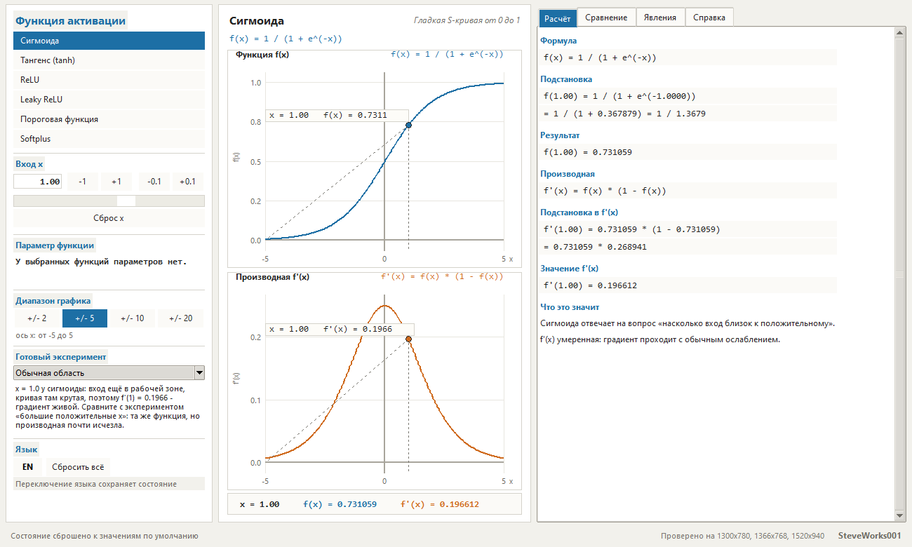
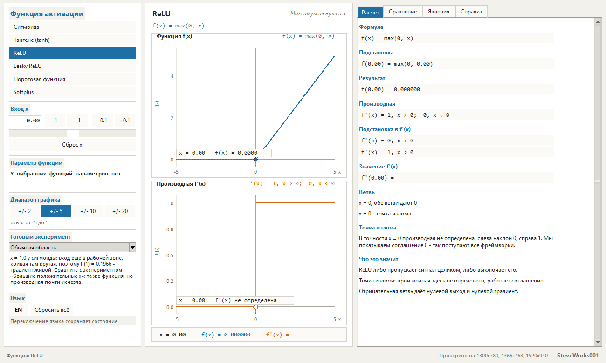
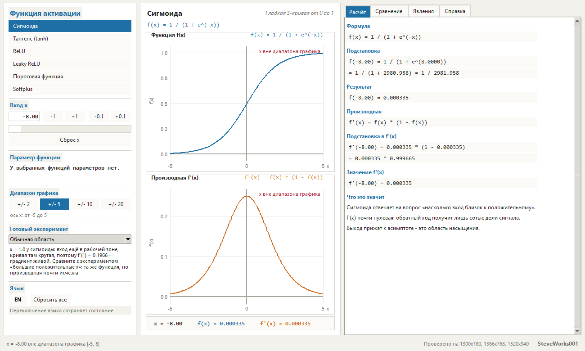
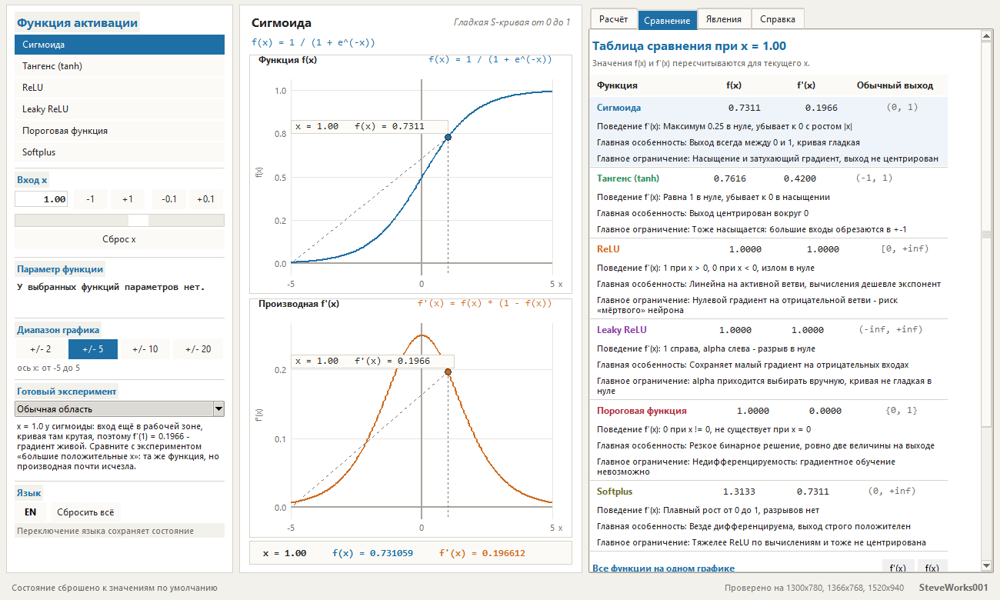
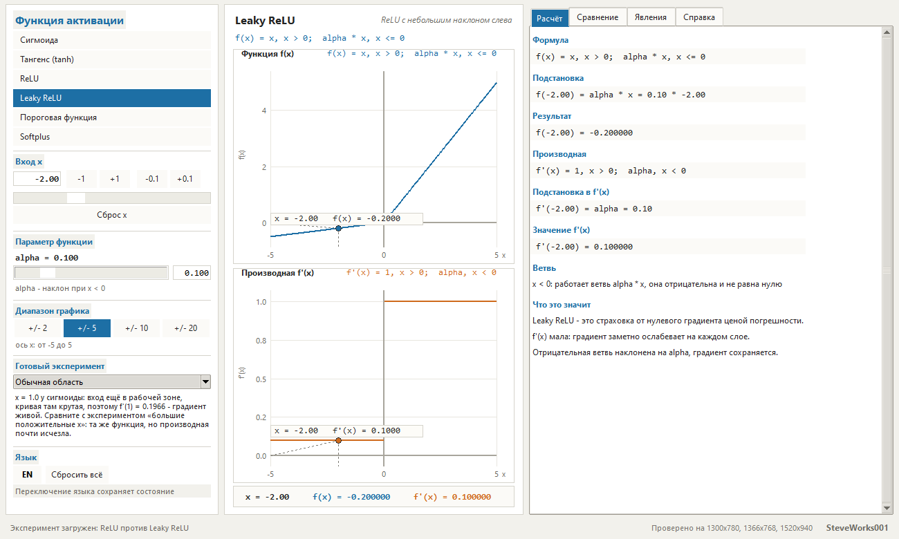
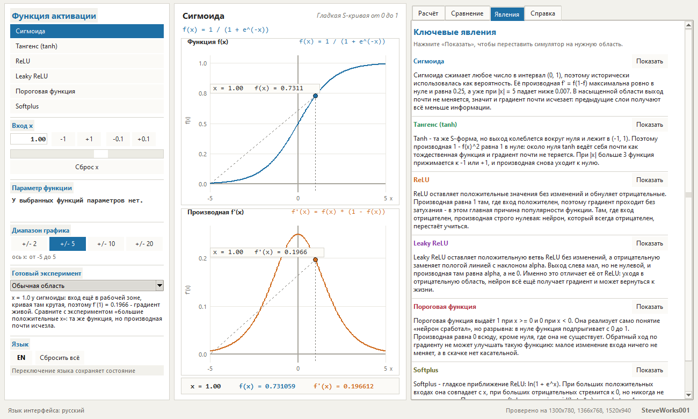
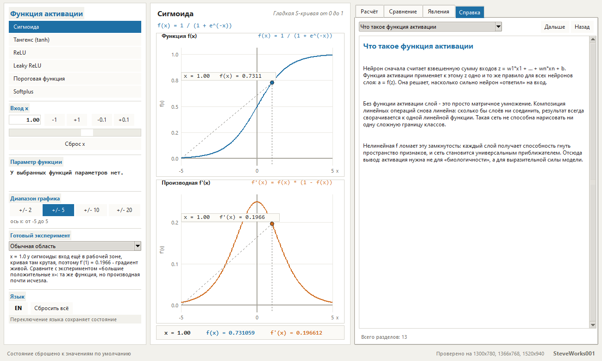

# Activation Functions Lab — учебный симулятор функций активации

Проект 7 из 13 серии учебных симуляторов нейронных сетей.
Однофайловое приложение на Python и Tkinter: только стандартная библиотека,
без внешних пакетов, без сети и без установки зависимостей.
Цепочка «x → f(x) → f'(x) → что случится с градиентом» показана для шести
функций активации сразу в трёх видах: крупными числами, двумя графиками (сама
функция и её производная) и разбором подстановки по строкам.

Текст на английском: [README_EN.md](README_EN.md).

---

## Назначение

Показать на настоящих числах, что функция активации делает с градиентом. Для
любого входа приложение одновременно отвечает на два разных вопроса: что нейрон
выдаёт (`f(x)`) и насколько сильно вход вообще на этот выход влияет
(`f'(x)`). К этим двум числам прилагается короткая смысловая строка — «f'(x)
близка к 1: градиент проходит почти без потерь», «f'(x) мала: градиент заметно
ослабевает на каждом слое», «f'(x) = 0: через эту точку градиент не проходит
вообще».

Предыдущий проект серии запускает сигмоиду внутрь полного цикла обучения и
показывает, как меняются веса от эпохи к эпохе. Там обратный ход умножает на
`f'(x)` молча. Здесь этот единственный множитель разобран сам по себе — для
шести функций сразу, при одном и том же входе, с числами и графиками.

Сеть здесь не обучается: одна точка, одна функция, и всё внимание отдано
производной.

### Чего в этом проекте нет

- нет сети: ни слоёв, ни прямого прохода, ни обратного распространения, ни
  датасета — ровно одна точка и одна функция;
- нет обучения: веса меняться негде, циклов и эпох нет, ничего не сходится и не
  расходится;
- нет других функций активации: в каталоге шесть, свою формулу задать нельзя;
- нет свободных параметров: `alpha` есть у Leaky ReLU, `beta` — у Softplus, у
  остальных четырёх функций параметров нет, и блок параметра для них
  скрывается;
- нет произвольного диапазона графика: четыре фиксированных — ±2, ±5, ±10,
  ±20;
- нет кривых обучения, статистики по итерациям и сравнения «до и после»;
- нет сохранения состояния, экспорта графиков, работы с файлами и логами;
- нет NumPy, pandas, SciPy, matplotlib, Pillow, TensorFlow, PyTorch, Keras,
  scikit-learn и любых пакетов из `pip`.

## Учебные цели

- Держать в голове две разные величины: `f(x)` — ответ нейрона, `f'(x)` — то,
  во сколько раз изменится этот ответ при малом сдвиге входа.
- Знать, что у сигмоиды производная максимальна в нуле и равна `0.25`, и
  понимать, что это потолок, а не типичное значение.
- Видеть насыщение на числах: `f'(8) = 0.000335` у сигмоиды и
  `f'(-5) = 0.000182` у тангенса — и понимать, почему сеть из таких множителей
  учится всё медленнее.
- Понять, что ноль на отрицательной ветви ReLU — это ровно ноль, а не
  «маленький градиент»: нейрон перестаёт учиться совсем.
- Понять, чем Leaky ReLU платит за спасённый градиент: наклон `alpha` слева,
  излом в нуле, ручной выбор параметра.
- Понять, почему пороговая функция не обучается градиентным спуском.
- Понять, что Softplus — это сглаженный ReLU, и как `beta` превращает мягкую
  кривую почти в ломаную.
- Принять соглашение о точке излома: `f'(0)` у ReLU, Leaky ReLU и пороговой
  функции не существует, и приложение не подставляет вместо неё выдуманное
  число.

## Математика: шесть функций активации

### Цепочка, вокруг которой построено всё приложение

```
x  ->  f(x)  ->  f'(x)  ->  что случится с градиентом
```

`f(x)` показывает, что нейрон выдаёт при данном входе. `f'(x)` — наклон
касательной, то есть насколько быстро этот выход меняется, когда вход сдвигают.
При обратном ходе градиент умножается именно на `f'(x)`, поэтому одно число из
второй колонки решает, дойдёт сигнал до предыдущего слоя или потеряется. Весь
интерфейс построен так, чтобы эти два числа и их смысл были видны одновременно.

### Формулы, производные и область значений

| Функция | Формула | Производная | Область значений | Параметр |
|---|---|---|---|---|
| Сигмоида | `f(x) = 1 / (1 + e^(-x))` | `f'(x) = f(x) * (1 - f(x))` | `(0, 1)` | — |
| Тангенс (tanh) | `f(x) = (e^x - e^(-x)) / (e^x + e^(-x))` | `f'(x) = 1 - f(x)^2` | `(-1, 1)` | — |
| ReLU | `f(x) = max(0, x)` | `f'(x) = 1, x > 0;  0, x < 0` | `[0, +inf)` | — |
| Leaky ReLU | `f(x) = x, x > 0;  alpha * x, x <= 0` | `f'(x) = 1, x > 0;  alpha, x < 0` | `(-inf, +inf)` | `alpha` |
| Пороговая функция | `f(x) = 1, x >= 0;  0, x < 0` | `f'(x) = 0, x != 0` | `{0, 1}` | — |
| Softplus | `f(x) = (1 / beta) * ln(1 + e^(beta * x))` | `f'(x) = sigmoid(beta * x)` | `(0, +inf)` | `beta` |

Обе функции с параметром считаются численно устойчиво: сигмоида ветвится по
знаку аргумента, Softplus — через `ln(1 + e^(-|z|))`, поэтому переполнения нет
даже на самых больших допустимых входах (`|x| = 100` при `beta = 20`).

### Те же шесть функций на одних и тех же входах

Ниже — значения ровно в том виде, в котором их печатает окно: меньше 1 — до
шести знаков после запятой, от 1 до 100 — четыре знака, от 100 до 100000 — три.
Начиная с 100000 (и для бесконечности с NaN) окно переходит на экспоненциальную
форму с тремя цифрами после запятой: `2.688e+43` в строке подстановки при
`x = -100` — это то же число, что печатает панель, а не другая точность.
Отрицательные значения, которые округляются до нуля, печатаются без минуса:
`0.000000`.

Насыщающиеся функции:

| x | Сигмоида f(x) | Сигмоида f'(x) | Tanh f(x) | Tanh f'(x) |
|---|---|---|---|---|
| -8.00 | 0.000335 | 0.000335 | -1.000000 | 0.000000 |
| -3.00 | 0.047426 | 0.045177 | -0.995055 | 0.009866 |
| -1.00 | 0.268941 | 0.196612 | -0.761594 | 0.419974 |
| 0.00 | 0.500000 | 0.250000 | 0.000000 | 1.0000 |
| 1.00 | 0.731059 | 0.196612 | 0.761594 | 0.419974 |
| 3.00 | 0.952574 | 0.045177 | 0.995055 | 0.009866 |
| 8.00 | 0.999665 | 0.000335 | 1.000000 | 0.000000 |

Кусочно-линейные и пороговая (`alpha = 0.1` — значение по умолчанию):

| x | ReLU f(x) | ReLU f'(x) | Leaky ReLU f(x) | Leaky ReLU f'(x) | Пороговая f(x) | Пороговая f'(x) |
|---|---|---|---|---|---|---|
| -8.00 | 0.000000 | 0.000000 | -0.800000 | 0.100000 | 0.000000 | 0.000000 |
| -1.00 | 0.000000 | 0.000000 | -0.100000 | 0.100000 | 0.000000 | 0.000000 |
| 0.00 | 0.000000 | - | 0.000000 | - | 1.0000 | - |
| 1.00 | 1.0000 | 1.0000 | 1.0000 | 1.0000 | 1.0000 | 0.000000 |
| 3.00 | 3.0000 | 1.0000 | 3.0000 | 1.0000 | 1.0000 | 0.000000 |
| 8.00 | 8.0000 | 1.0000 | 8.0000 | 1.0000 | 1.0000 | 0.000000 |

Softplus (`beta = 1` — значение по умолчанию):

| x | f(x) | f'(x) |
|---|---|---|
| -8.00 | 0.000335 | 0.000335 |
| -1.00 | 0.313262 | 0.268941 |
| 0.00 | 0.693147 | 0.500000 |
| 1.00 | 1.3133 | 0.731059 |
| 3.00 | 3.0486 | 0.952574 |
| 8.00 | 8.0003 | 0.999665 |

Прочерк в колонке производной — это не ноль: в этих точках производной не
существует (об этом отдельный раздел ниже).

### Насыщение: сигмоида и тангенс

Сигмоида сжимает всю числовую прямую в интервал `(0, 1)`, и расплата за это —
производная, максимальная ровно в нуле (`0.25`) и быстро тающая дальше:
`0.045177` при `x = 3`, `0.006648` при `x = 5`, `0.000335` при `x = 8`. Сигмоида
насыщается симметрично: при `x = -8` производная та же `0.000335`. Тангенс в
нуле даёт `f'(0) = 1` — вокруг нуля он почти тождественная функция, — но при
`x = 3` остаётся `0.009866`, а при `x = -5` — `0.000182`.

При `|x|` на верхней границе ввода (`x = 100`) обе функции равны своим
асимптотам ровно: `1.0` и `-1.0`, а их производные — ровно `0`. Это не баг и не
предел точности приложения, а свойство арифметики двойной точности, и оно
показано здесь как часть урока.

Как только выход отличается от своей асимптоты менее чем на `0.02`, приложение
добавляет строку «Выход прижат к асимптоте — это область насыщения».

### Отрицательная ветвь: ReLU и Leaky ReLU

ReLU оставляет положительную ветвь без изменений, а отрицательную обнуляет:
`f(-3) = 0` и `f'(-3) = 0`, `f(3) = 3` и `f'(3) = 1`. Плюс отрицательной ветви в
том, что на ней градиент не ослабевает вообще; минус в том, что `0` здесь — это
не «маленький градиент», а его полное отсутствие: нейрон, который всегда
отрицателен, перестаёт учиться. Приложение печатает об этом отдельную строку
при любом `x <= 0`.

Leaky ReLU меняет отрицательную ветвь на пологую прямую с наклоном `alpha`:
при `x = -2` и `alpha = 0.1` это `-0.2` и `0.1`. Таблица ниже показывает, что
меняет один параметр:

| alpha | f(-2) | f'(-2) |
|---|---|---|
| 0.01 | -0.020000 | 0.010000 |
| 0.10 | -0.200000 | 0.100000 |
| 0.50 | -1.0000 | 0.500000 |

Положительная ветвь при этом совпадает с ReLU, а кривая остаётся с изломом в
нуле.

### Пороговая функция: почему её нельзя обучить

Она выдаёт `1` при `x >= 0` и `0` при `x < 0` — ровно две величины, и реализует
само понятие «нейрон сработал». Производная равна нулю всюду, где она вообще
есть, а в нуле функция разрывна, поэтому производной там нет вовсе. В поле
значений при `x = 0` стоит прочерк, а не ноль, и в разборе прямо сказано, что
производная не существует. Обратный ход по такому нейрону не может улучшать
веса: малое изменение входа ничего не меняет, а в скачке нет касательной. Это
единственная функция из шести, у которой разрыв есть на самом графике функции.

### Softplus и параметр beta

Softplus — гладкое приближение ReLU: при больших положительных входах она
совпадает с `x`, при больших отрицательных стремится к нулю, но никогда его не
достигает, а её производная — это обычная сигмоида, только сжатая по горизонтали
в `beta` раз. Отсюда важное: `f'(0) = 0.5` при любом `beta`, а `f(0) = ln(2) /
beta`.

| beta | f(1) | f'(1) | f(-1) | f'(-1) | f(0) |
|---|---|---|---|---|---|
| 1.0 | 1.3133 | 0.731059 | 0.313262 | 0.268941 | 0.693147 |
| 5.0 | 1.0013 | 0.993307 | 0.001343 | 0.006693 | 0.138629 |
| 20.0 | 1.0000 | 1.000000 | 0.000000 | 0.000000 | 0.034657 |

Чем больше `beta`, тем ближе кривая к ломаной ReLU. Обратите внимание на строку
`beta = 20` при `x = -1`: на экране `0.000000`, но это округление при выводе —
математическое значение там примерно `1e-10`, и оно строго положительно.
Настоящий машинный ноль начинается при `beta * x` меньше примерно `-745`:
например, при `beta = 20` и `x = -100` приложение печатает `0.000000` и
добавляет отдельную строку о том, что `e^z` стал меньше машинного нуля.

### Точка излома: производной в нуле нет

У ReLU, Leaky ReLU и пороговой функции `f'(0)` не существует. Приложение никогда
не показывает вместо неё выдуманное число:

- в строке значений производная показана как `f'(x) = -`;
- в разборе печатаются обе односторонние производные отдельными строками:
  `f'(x) = 0, x < 0` и `f'(x) = 1, x > 0` у ReLU, а у Leaky ReLU левая строка
  называет число `alpha` (при `alpha = 0.1` это `f'(x) = 0.10, x < 0`); итог в
  обоих случаях `f'(0.00) = -`;
- там же появляется блок «Точка излома» с объяснением, а в смысловой строке —
  «Точка излома: производная здесь не определена, работает соглашение»;
- график производной доходит до разрыва, а то, каким числом заполнен сам
  излом, — соглашение отрисовки: `0` для ReLU и `alpha` для Leaky ReLU.

Для пороговой функции сказано отдельно, что в нуле производная не «равна нулю»,
а не существует: функция там разрывна. Поэтому в её разборе вместо двух
односторонних строк печатается одна: `f'(0) -> производная не существует`, а
итог — `f'(0) = -`.

## Интерфейс и как пользоваться

Одно окно, три колонки: слева настройки, в центр — сами числа и два графика,
справа — четыре вкладки с разбором, сравнением, явлениями и справкой.

### Левая колонка

Шесть блоков, названных так же, как на экране:

- «Функция активации» — шесть кнопок, выбранная подсвечивается;
- «Вход x» — поле ввода, кнопки `-1`, `+1`, `-0.1`, `+0.1`, слайдер с шагом
  `0.05` и «Сброс x»;
- «Параметр функции» — слайдер и поле для `alpha` или `beta`, подпись вида
  `alpha = 0.100` и подсказка («alpha — наклон при x < 0», «beta — крутизна
  сглаживания»); у функций без параметров слайдер и поле скрываются, остаётся
  только надпись «У выбранных функций параметров нет.»;
- «Диапазон графика» — четыре кнопки `+/- 2`, `+/- 5`, `+/- 10`, `+/- 20` и
  подпись «ось x: от -5 до 5»;
- «Готовый эксперимент» — выпадающий список из девяти наборов;
- «Язык» — кнопка переключения и «Сбросить всё».

### Центр: числа и два графика

Крупная моноширинная строка `x = `, `f(x) = `, `f'(x) = ` и два графика:
«Функция f(x)» (синий) и «Производная f'(x)» (оранжевый). Оси, сетка, нулевые
линии, деления, подписи, легенда и маркер текущей точки рисуются вручную на
холсте Tkinter. Маркер подписан короче, чем строка значений: `x = 1.00
f(x) = 0.7311`, а на графике производной в точке излома — `x = 0.00   f'(x) не
определена`. Если `x` вышел за пределы выбранного диапазона, точка помечается
«x вне диапазона графика», а то же самое появляется в строке состояния; когда
производная тождественно равна нулю, график показывает «Кривая совпадает с
осью x».

### Правая колонка: четыре вкладки

**«Расчёт»** — вся цепочка, а не только результат: «Формула», «Подстановка»,
«Результат», «Производная», «Подстановка в f'(x)», «Значение f'(x)», «Ветвь»,
«Точка излома» и «Что это значит». Для сигмоиды при `x = 1` это выглядит так:

```
f(1.00) = 1 / (1 + e^(-1.0000))
        = 1 / (1 + 0.367879) = 1 / 1.3679
f(1.00) = 0.731059

f'(1.00) = 0.731059 * (1 - 0.731059)
         = 0.731059 * 0.268941
f'(1.00) = 0.196612
```

**«Сравнение»** — таблица «Таблица сравнения при x = …» с колонками «Функция»,
`f(x)`, `f'(x)` и «Обычный выход» (область значений функции), ниже — три строки
на каждую функцию: «Поведение f'(x)», «Главная особенность», «Главное
ограничение»; строка выбранной функции подсвечена. Значения пересчитываются при
каждом изменении `x`. Там же блок «Все функции на одном графике» с
переключателями `f(x)` и `f'(x)`, легендой и вертикальной линией на текущем
входе.

**«Явления»** — шесть блоков «Ключевые явления», по одному на функцию: абзац
объяснения и кнопка «Показать», которая сама переставляет симулятор в нужную
область (например, `x = -5` для насыщения тангенса или `x = 0` для излома).

**«Справка»** — 13 разделов в выпадающем списке с кнопками «Назад» и «Дальше»:
что такое функция активации, что такое `f(x)`, что такое производная, зачем
производная в обратном распространении, по разделу на каждую из шести функций,
насыщение и затухающий градиент, «мёртвый» ReLU и как пользоваться симулятором.

Содержимое вкладок «Расчёт», «Сравнение» и «Явления» прокручивается внутри
собственной панели. Оба графика, поле `x` и выбор диапазона от прокрутки не
зависят: они всегда на экране.

### Готовые эксперименты

Девять наборов, каждый выставляет функцию, `x`, диапазон и параметр сам:

| Эксперимент | Что выставляет | Что видно |
|---|---|---|
| Обычная область | Сигмоида, `x = 1`, ±5 | `f = 0.731059`, `f' = 0.196612` — градиент живой |
| Большой отрицательный x | Сигмоида, `x = -8`, ±10 | выход прижат к 0, `f' = 0.000335` |
| Большой положительный x | Сигмоида, `x = 8`, ±10 | `f = 0.999665` при том же `f' = 0.000335` |
| Около нуля | Tanh, `x = 0.1`, ±2 | кривая почти прямая, `f' = 0.990066` |
| ReLU: отрицательная область | ReLU, `x = -3`, ±5 | `f = 0`, `f' = 0` — нейрон «спит» |
| ReLU: положительная область | ReLU, `x = 3`, ±5 | `f = 3`, `f' = 1` — без затухания |
| ReLU против Leaky ReLU | Leaky ReLU, `x = -2`, ±5, `alpha = 0.1`, вкладка «Сравнение» | один вход: 0 и 0 против -0.2 и 0.1 |
| Насыщение сигмоиды | Сигмоида, `x = 6`, ±10 | `f' = 0.002467` против `0.25` в нуле |
| Насыщение tanh | Tanh, `x = -5`, ±10 | `f = -0.999909`, `f' = 0.000182` |

### Поля и пределы

- `x` — любое число по модулю не больше `100`; разделитель можно ставить точкой
  или запятой. При ошибке поле подсвечивается, внизу появляется «Неверное
  значение x: нужно число» или «Неверное значение x: по модулю не больше 100», а
  расчёт остаётся на прежнем значении.
- Слайдер `x` ходит только в границах выбранного диапазона графика; значения
  дальше задаёт поле ввода, и тогда точка помечается как вышедшая за диапазон.
- `alpha` — от `0.01` до `0.50` с шагом `0.01`, по умолчанию `0.10`.
- `beta` — от `0.5` до `20.0` с шагом `0.5`, по умолчанию `1.0`. Значение вне
  разрешения не подставляется молча: поле подсвечивается и появляется сообщение
  «Неверное значение параметра beta: значение вне разрешённого диапазона».
- «Сброс x» возвращает `x = 1.00`. «Сбросить всё» ставит сигмоиду, `x = 1.00`,
  диапазон ±5, `alpha = 0.10`, `beta = 1.0` и первый раздел справки; открытая
  вкладка при этом не меняется.
- Внизу слева — строка состояния: она пишет, что произошло (выбранная функция,
  новый диапазон, загруженный эксперимент, ошибка ввода).

### Язык

Интерфейс двуязычный: русский и английский. Кнопка переключения всегда показывает
другой язык — в русском интерфейсе на ней написано `EN`. Переключение не
перезапускает приложение и сохраняет всё состояние: функцию, `x`, параметры,
диапазон, открытую вкладку и режим сравнения.

Формулы, обозначения и названия функций (`Softplus`, `alpha`, `beta * x`)
одинаковы в обоих языках: математика не переводится, переводятся только подписи,
объяснения и сообщения об ошибках. Названия вкладок, блоков и кнопок в этом
документе приведены так, как они выглядят в русском интерфейсе.

## Учебные опыты

Все числа ниже — ровно то, что печатает окно приложения в панели расчёта; они
воспроизводимы, потому что здесь нет ни случайных весов, ни обучения: одна
функция, одно `x`, один результат.

**1. Максимум производной сигмоиды — ниже, а не выше.** Запустите приложение
(выбрана сигмоида, `x = 1.00`) и жмите `-0.1`, а не `+0.1`.
Наблюдайте: `f'(x)` идёт 0.196612 (x = 1.00) → 0.205500 (x = 0.90) → 0.235004
(x = 0.50) → 0.249376 (x = 0.10) → 0.250000 (x = 0.00). В сторону `+0.1`
производная только уменьшается: на `x = 8` это 0.000335.
О чём подумать: почему максимум стоит именно в нуле (здесь `f'(x) = f(x)·(1 −
f(x))`, а `f(0) = 0.5`) и что это значит для нейрона, чей входной сигнал ушёл
далеко от нуля.

**2. Насыщение: два готовых эксперимента.** В списке «Готовый эксперимент»
выберите «Насыщение сигмоиды», затем «Большой отрицательный x».
Наблюдайте: при `x = 6.00` — `f = 0.997527` и `f' = 0.002467`; при `x = -8.00`
обе колонки печатают одно и то же число 0.000335 (точные значения 0.00033535 и
0.00033524 расходятся в восьмом знаке), а строка подстановки показывает
`1 / (1 + 2980.958)`.
О чём подумать: почему при большом |x| значения функции и её производной
выглядят одинаково — `f' = f·(1 − f)`, и когда `f` близко к нулю, множитель
`(1 − f)` почти ничего не меняет; когда `f` близко к единице — то же самое
делает сам `f`.

**3. ReLU против Leaky ReLU.** Выберите готовый эксперимент «ReLU против
Leaky ReLU».
Наблюдайте: он сам ставит leaky ReLU, `x = -2.00`, `alpha = 0.10` и открывает
вкладку сравнения: `f = -0.200000`, `f' = 0.100000`. У обычной ReLU на том же
`x` — `f = 0.000000` и `f' = 0.000000`, и при `x = -3` производная остаётся
ровно нулём.
О чём подумать: что делает нулевой множитель с градиентом предыдущего слоя;
`alpha` доступен в пределах 0.01…0.5 — при каком `alpha` «мёртвый» нейрон
становится просто медленным и чем это платить на положительных входах.

**4. Излом в нуле: прочерк вместо числа.** Поставьте `x = 0.00` по очереди на
ReLU, Leaky ReLU и пороговой функции.
Наблюдайте: в колонке `f'(x)` вместо числа стоит `-`, а под расчётом
появляется пояснение про излом. У пороговой функции в той же точке `f =
1.0000`, и пояснение прямо говорит, что производная не существует: ноль на
графике — условность рисовки, а не посчитанное значение.
О чём подумать: почему приложение печатает прочерк, а не 0; в каком месте
реального обучения встречается такой вход и что там происходит с обновлением
весов.

**5. Softplus и его сглаживающий параметр.** Для Softplus при `beta = 1`
(по умолчанию): `x = -3` → `f = 0.048587`, `f' = 0.047426`; `x = 0` → 0.693147
и 0.500000; `x = 8` → 8.0003 и 0.999665. Поставьте `beta = 20` и повторите
`x = -3` и `x = 0`.
Наблюдайте: при `beta = 20` на `x = -3` обе колонки печатают `0.000000`, хотя
приложение считает 4.378e-28 и 8.757e-27; строка подстановки показывает
`z = beta * x = -60.0000, e^z ~= 0` и отдельную заметку «При beta*x < -50
экспонента мала: ln(1 + e^z) практически равно e^z, то есть почти 0». На
`x = 0` производная при любом `beta` остаётся 0.500000, а значение функции
падает с 0.693147 до 0.034657.
О чём подумать: как `beta` превращает мягкую кривую в почти прямую; чем
«почти ноль на экране» опаснее честного нуля и где ещё в этом интерфейсе шесть
знаков после запятой — это предел показа, а не предел расчёта.

## Установка и запуск

Приложение — один файл; сборки и установки зависимостей не требуется.

Windows:

```bash
python activation_functions_lab.py
```

macOS и Linux:

```bash
python3 activation_functions_lab.py
```

Аргументы командной строки не нужны. Быстрый старт: при запуске выбрана
сигмоида, `x = 1.00` и диапазон ±5. Нажмите `-0.1` десять раз, пока `x` не
станет `0.00`, а `f'(x)` — `0.250000`: это максимум производной сигмоиды, и в
сторону `+0.1` он только уменьшается. Затем кнопками `-1` уйдите в `x = -8` и
сравните `f'(x)`. После этого переключитесь на ReLU, нажмите `-1` до `x = -3` и
посмотрите, что производная становится ровно нулём, а готовый эксперимент «ReLU
против Leaky ReLU» сам откроет вкладку сравнения.

Окно открывается размером примерно 1300×780 и не уменьшается примерно ниже
1024×640.

## Скриншоты

Снимки сделаны из работающего приложения, окно открыто размером 1300x780 — это
размер по умолчанию. Тот же интерфейс проверен на 1366x768 и 1520x940; оба
размера перечислены в строке состояния в левом нижнем углу окна.

**Главный экран: вкладка «Расчёт», выбрана сигмоида, `x = 1.00`**



**ReLU ровно в нуле: производная показана прочерком, а не нулём**



**Насыщение: сигмоида при `x = -8.00`**



**Вкладка «Сравнение»: шесть функций при одном входе**



**Готовый эксперимент «ReLU против Leaky ReLU»**



**Вкладка «Явления»: шесть блоков с кнопками «Показать»**



**Вкладка «Справка»**



## Требования

- Python 3.8 или новее.
- Tkinter — входит в официальные сборки Python для Windows и macOS; в некоторых
  дистрибутивах Linux ставится отдельно как пакет `python3-tk`.
- Только стандартная библиотека: `math`, `tkinter`, `tkinter.ttk`.
- Не используются: NumPy, pandas, SciPy, matplotlib, Pillow, TensorFlow,
  PyTorch, Keras, scikit-learn и любые пакеты из `pip`.
- Сетевое соединение для работы приложения не требуется.

## Ограничения

- **Одна точка и одна функция.** Это учебный стенд, а не слой и не сеть: здесь
  нет прямого прохода, обратного распространения, датасета и обучения.
- **Производная в изломе — соглашение отрисовки.** Кривая производной доходит до
  разрыва, а заполняющее излом число (`0` для ReLU, `alpha` для Leaky ReLU) не
  означает, что производная существует.
- **Шесть функций — весь список.** Softmax, GELU, ELU, PReLU и другие активаторы
  не добавляются, свою формулу задать нельзя.
- **Значения выводятся с ограниченным числом знаков** (до шести, при `|v| >= 1`
  — четыре, при `|v| >= 100` — три), поэтому `0.000000` на экране — это часто
  очень малое положительное число, а не настоящий ноль. Отдельная строка
  появляется только когда значение стало ровно машинным нулём.
- **Насыщение сигмоиды и тангенса — свойство float.** При больших `|x|` их
  значения равны ровно `1.0` и `-1.0`, поэтому производная там ровно `0`.
- **Машинный ноль у Softplus.** При `beta * x` меньше примерно `-745` значение
  округляется до ровно `0.0`, хотя математически оно положительно; приложение
  говорит об этом отдельной строкой.
- **Ввод ограничен по модулю (`|x| <= 100`), а слайдер — ещё и выбранным
  диапазоном.** Две самые большие стрелки шкалы не дают смотреть на кривую
  дальше `±20`.
- **`alpha` выбирает человек.** Подбора параметра, автоматических подсказок по
  нему и сравнения нескольких значений на одном графике нет.
- **Пороговая функция приведена как отрицательный пример.** Её раздел объясняет,
  почему градиентное обучение с ней невозможно, а не как её обучать.
- **Только графический интерфейс.** Нет консольного режима, API, пакетного
  прогона, сохранения состояния и экспорта графиков; данные не читаются из
  файлов.
- **Это учебный симулятор, а не промышленный фреймворк машинного обучения.**
  Он нужен, чтобы понять один множитель обратного хода, а не чтобы обучить
  модель.

## Учебная оговорка

Симулятор показывает один механизм — как `f'(x)` влияет на градиент, — и часть
соглашений выбрана ради наглядности. Функции и их производные заданы в том
виде, в каком их печатают учебники, а не в виде оптимизированных библиотечных
реализаций; устойчивые записи (`log1p`, ветвление по знаку) нужны только для
того, чтобы большие входы не превращались в `inf` на глазах у читателя.
Пороговая функция включена в набор именно как случай, который градиентом не
обучается, а Leaky ReLU показана с рук выбираемым `alpha`, хотя на практике
его обычно фиксируют. Смысловые строки («градиент проходит почти без потерь»,
«градиент заметно ослабевает») — это грубые ступени по величине `f'(x)`, а не
утверждение о конкретной сети: реальный градиент зависит ещё и от всех
последующих слоёв, а здесь считается только один множитель.

## Что нужно знать заранее

**Строго необходимо:** Python 3 с Tkinter и запуск одного файла из командной
строки. Пакеты из `pip`, сеть и внешние файлы не нужны.

**Математика:** производная как наклон касательной — то есть ответ на вопрос,
насколько быстро меняется выход, когда вход сдвигают. Вычислять производные
самому не придётся: для всех шести функций `f'(x)` уже посчитана и показана
отдельной строкой с подстановкой чисел. Достаточно уметь читать короткие
выражения с `e^x` и `ln` и не путать знак.

**Полезно, но не обязательно:** проект 1 «Один искусственный нейрон» — там `σ(z)`
считается по числам и становится ответом нейрона; проект 2 «Перцептрон» —
пороговая функция из этого списка и есть правило его решения; проект 5
«Обратное распространение» — там `f'(x)` превращается в множитель цепочки и
становится видно, зачем нужен её максимум.

**О версии Python:** раздел «Требования» называет Python 3.8 или новее.
Приложение версию не проверяет, а запуск на других версиях не тестировался —
это объявленная совместимость, а не проверенная гарантия.

## Место в серии

Проект 7 из 13. Порядок не строгий: каждый проект запускается сам по себе и
ничего не читает из соседних. Ниже только те связи, которые есть по содержанию.

| Проект | Связь по содержанию |
|---|---|
| 1 — Один искусственный нейрон | там `σ(z)` даёт ответ нейрона; здесь та же функция разобрана вместе с её наклоном |
| 2 — Perceptron | пороговая функция из списка — правило решения перцептрона; там она работает, здесь у неё ищут производную |
| 5 — Backpropagation | `f'(x)` из этой таблицы становится множителем цепочки правил |
| 6 — Neural Network Training | то же умножение на `f'(x)`, но повторённое циклом эпох |
| 8 — Loss Functions | потеря решает, какое число стоит слева от `f'(x)`; здесь разобрана только правая часть произведения |
| 12 — CNN Convolution | там ReLU — переключатель после свёртки; здесь у неё разобран каждый вход и излом в нуле |

## Разработчик

**Разработчик: SteveWorks001**

## Лицензия

Проект распространяется под лицензией MIT; полный текст лежит в файле
[LICENSE](LICENSE).

